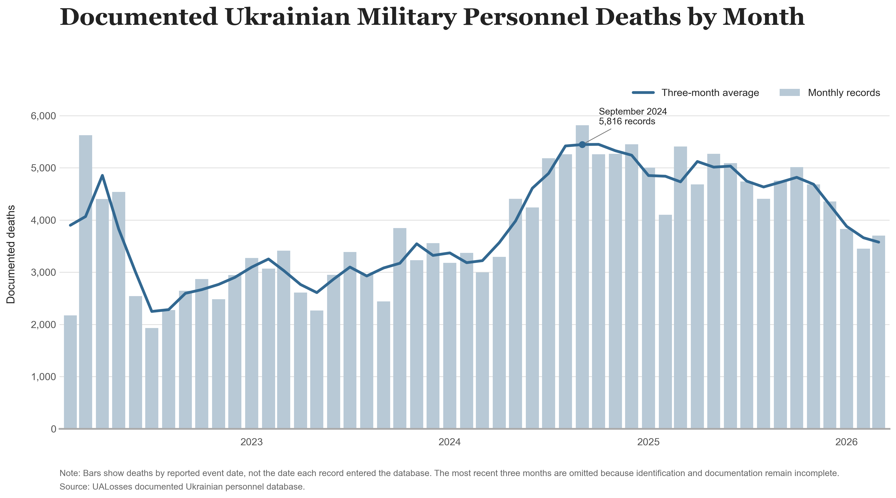
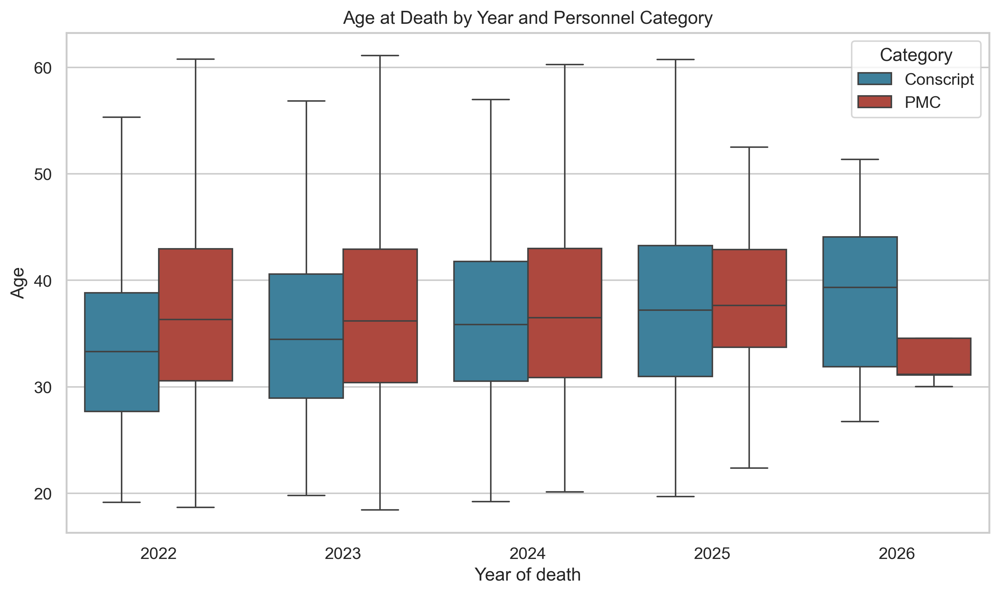
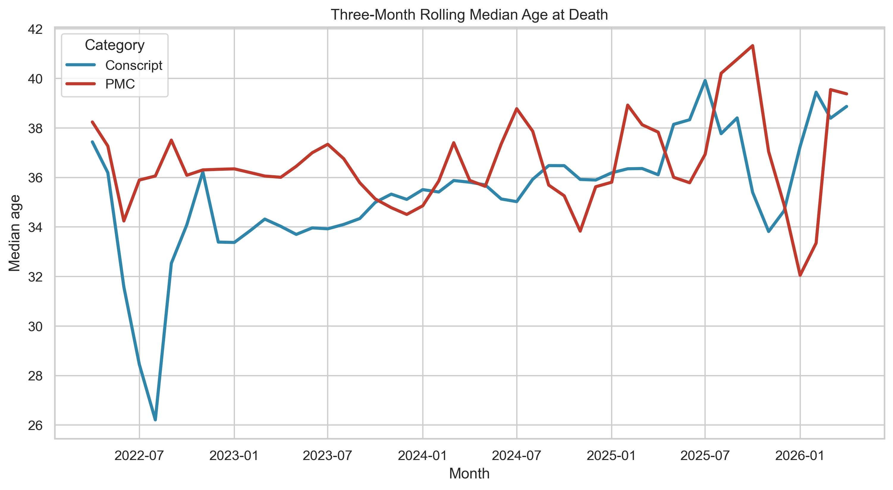

Data and code used to create graphics and see if datasets are a fit for my substack, which can be found through this link: https://substack.com/@lucasan1?utm_source=user-menu

Lots of data pertaining to the war in Ukraine is incomplete, as the war is still going on. Many of the graphics and datasets used here will not be published on my substack. 

Some examples of graphs I have created

### Ukrainian Deaths by Month


### Age at Death by Year and Personnel


### Three Month Rolling Median Age at Death for PMCS and Conscripts


## Data Sources
- **Poteru:** Documented Russian military deaths, including age, rank, location, branch, PMC status, and conscript status.
- **VIINA:** Geolocated event and media-reporting from the war in Ukraine.

## Limitations
- Documented deaths are not equivalent to total deaths.
- Records from recent months may be incomplete.
- PMC, conscript, rank and branch labels depend on available public information.
- Geographic totals may reflect population size and uneven reporting.
- VIINA measures reported events and language, not every battlefield event.

## Repository Structure (10/23/26)
```text
myproject1/
├── casualty_analysis/
│   ├── data/
│   └── casualty_analysis.ipynb
│
├── substack/
│   ├── data/
│   ├── figures/
│   ├── dedovshchina.ipynb
│   ├── poteru.ipynb
│   ├── total_loss.ipynb
│   └── future.ipynb
│
├── .gitattributes
└── README.md
```

## Related Writing
https://lucasan1.substack.com/p/fear-moves-down-lies-move-up-what 